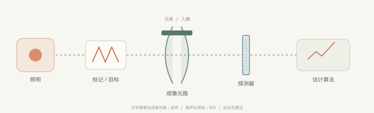
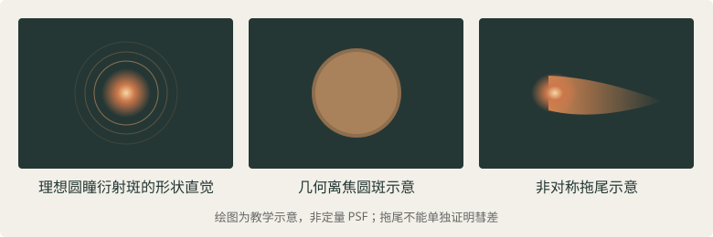
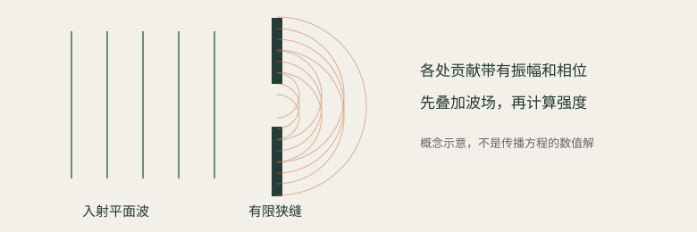

# 第 1 周完整讲义 · 按教学逐字稿重建

课程依据用户提供的《第一周教学逐字稿.md》重建。正文沿用原文讲解，删除完全重复的第一课，修复公式转义、矩阵换行与 Python 排版。课堂界面上的参数读数以历史示例保留；整理补充另行标注。原稿没有学生作答记录，因此不能推断个人答题结果。

[原始逐字稿](../archive/第一周教学逐字稿.md) · [整理与核对记录](../docs/逐字稿整理与核对记录.md)

今天正式开始第1周：传感成像光路与像差概念。

我会按照你上传的12周学习计划来教学，但不直接把一大堆知识点扔给你。我们采用这样的方式：光学概念 → 物理直觉 → 数学推导 → 软件仿真 → 问题诊断。每讲完一个关键概念，我会让你回答一个问题，确认理解后再继续。

### 第1周学习路线

本周目标

12小时

理解一个光刻传感器如何形成图像，以及如何初步区分离焦、光学像差和探测误差。

1\. 成像光路与基本概念

物面、像面、光轴、光阑、入瞳、视场

2小时

2\. 近轴成像与数学模型

薄透镜公式、放大率、光线追迹

2小时

3\. 光学像差的物理含义

离焦、球差、彗差、像散等

2小时

4\. Python几何光学仿真

改变物距、像面和光阑，观察光线变化

4小时

5\. 问题定位与复盘

异常清单、候选原因、知识验收

2小时

## 01 · 一个理想的点，为什么会变成光斑？

目标：区分衍射、像面离焦和高阶像差，复算 50 mm 透镜的成像位置。

原稿行号：45–152

### 第一课：一个理想的点，为什么在传感器上会变成光斑？

这是本周最重要的起点。

先看一个简化的成像系统：



假设我们在物面上有一个极小的发光点。它发出的光经过透镜，最终到达探测器。

在几何光学中，理想情况下，来自同一个物点的光线经过透镜后，会重新汇聚到同一个像点。

但是现实中，探测器上通常看到的不是一个无限小的点，而是具有一定面积的光斑。

这里有三个不同的原因：

1. 衍射（Diffraction）：即使透镜完全理想，光通过有限孔径后，也无法汇聚成数学上的无限小点。
2. 离焦（Defocus）：探测器没有放在正确的成像位置，光线尚未汇聚或已经发散。
3. 光学像差（Optical Aberration）：真实光学系统偏离理想成像条件，使光线或波前产生额外偏差。



示意图仅用于建立形状直觉。真实光斑取决于光阑、波长、波前、采样等条件，不能仅凭形状判断原因。

#### 1. 先理解理想成像

对于一个薄透镜，最基本的成像关系是：

$$
\frac{1}{f}=\frac{1}{u}+\frac{1}{v}
$$

其中：

- $f$：透镜焦距
- $u$：物体到透镜的距离
- $v$：像到透镜的距离

例如，焦距为50 mm的透镜，物体位于透镜前100 mm。

$$
\frac{1}{50}=\frac{1}{100}+\frac{1}{v}
$$

计算得到：

$$
v=100\ \mathrm{mm}
$$

也就是说，在近轴薄透镜模型下，探测器放在透镜后100 mm处，物体就能清晰成像。

如果探测器放在110 mm处，就产生了离焦。

注意：这个公式只能描述理想近轴成像的位置关系，不能预测真实镜头的彗差、球差等高阶像差。

#### 2. 用一个可交互的模型观察离焦

下面的模型只使用几何光线，暂时忽略衍射与真实镜头像差。你可以移动探测器，观察光线在哪里汇聚。

| 课堂界面参数 | 记录值 |
| --- | --- |
| 探测器位置 v | 110 mm |
| 入射光束半径（示意） | 14 单位 |
| 相对理想像面偏移 | +10 mm |
| 几何光斑直径（示意） | 2.80 单位 |

探测器位于理想像面之后，光线已经开始重新发散。

这个交互模型要帮助你建立一个重要直觉：光斑变大，并不意味着透镜一定产生了高阶像差，也可能只是探测面位置不对。

### 3. 第一道理解检查

一个理想、没有高阶像差的透镜，已经将光线准确聚焦在探测器上。

问题：此时探测器上是否还能看到具有一定面积的光斑？

A. 不可能，理想透镜一定形成无限小的点

B. 可能，因为有限孔径会产生衍射

C. 可能，但这说明一定存在球差

D. 不确定，取决于探测器有没有噪声

这也是你之后学习PSF（点扩散函数）、波前像差和光刻机像差测量传感器的基础。

先完成这道题。下一步我们进入光阑、入瞳与视场的区别，尤其是为什么光阑位置和大小会影响成像，以及这些概念怎样对应到光刻机传感器光路。

> 整理补充：课堂的“14 单位、2.80”是示意坐标。若把孔径半径定义为 14 个同一横向单位，则 2×14×10/100=2.80；这些数字不能当作设备光斑的微米实测值。物距 100 mm 时像距为 100 mm，有限共轭的离焦圈用像距 v 作分母。

> 操作任务：在 ABCD 模拟器设置 f=50 mm、u=100 mm、探测器偏移 +10 mm；比较准确对焦与离焦。


## 02 · 光阑、入瞳与视场

目标：分清一个物点的光锥与多个物点的视场，观察孔径与离焦的相反趋势。

原稿行号：305–448

继续第1周的第二部分：光阑、入瞳与视场。

上一节我们知道，理想透镜也会因为衍射形成光斑，而离焦会让光斑扩展。现在要解决一个更基础的问题：

为什么同一个透镜，改变光阑大小，既会影响成像亮度，又会影响光斑大小？而改变视场位置，又可能让像差发生变化？

### 一、先建立成像光路的空间概念

在一个简化的光刻标记成像传感器中，我们可以把光路分为：


概念链路图，并非特定光刻机传感器的实际元件顺序。真实光阑可位于透镜内部或其他位置。

这里需要理解四个概念。

| 概念   | 英文             | 主要作用            |
| ---- | -------------- | --------------- |
| 光轴   | Optical axis   | 描述系统的参考轴线       |
| 孔径光阑 | Aperture stop  | 限制一个物点能够通过的光线锥  |
| 入瞳   | Entrance pupil | 从物方观察到的孔径光阑的像   |
| 视场   | Field of view  | 描述系统能够成像的物体空间范围 |

其中最容易混淆的是孔径和视场。

孔径主要描述一个物点有多少角度范围的光线可以进入系统；视场则描述哪些不同位置的物点能够被成像。

### 二、孔径为什么会影响光斑？

我们先研究最简单的圆形孔径。

在其他条件不变的情况下，孔径直径为 $D$，焦距为 $f$，波长为 $\lambda$，理想圆瞳的Airy斑第一暗环半径近似为：

$$
r_{\mathrm{Airy}}\approx1.22\frac{\lambda f}{D}
$$

这说明一个很有意思的关系：

孔径越大，理想衍射光斑越小。

但在存在离焦时，更大的孔径也意味着更大的光线锥角，因此同样的像面偏移可能产生更大的几何离焦光斑。

这两种效应恰好存在竞争关系。

#### 交互实验：改变孔径与离焦

下面固定焦距50 mm、教学波长550 nm，使用近轴近似分别计算衍射斑半径和离焦几何斑半径。

| 课堂界面参数 | 记录值 |
| --- | --- |
| 孔径直径 D | 5.0 mm |
| 离焦量 Δz | 0.00 mm |
| 衍射斑半径 | 6.71 μm |
| 几何离焦半径 | 0.00 μm |

这是两个近似尺度的比较，不是实际PSF仿真。图中的合成半径只用于示意，不能代替波动光学传播计算。恢复初始参数

你可以做两个对照：

1. 让离焦量保持0，逐渐增大孔径。衍射斑会变小。
2. 让离焦量保持0.1 mm，再逐渐增大孔径。几何离焦斑会变大。

这就解释了为什么实际光学设计不能简单认为孔径越大越好。

### 三、入瞳和光阑到底有什么区别？

光阑是实际限制光线通过的元件或边界，而入瞳是从物方通过前面的光学元件看到的光阑像。

如果光阑前面没有其他光学元件，那么入瞳可能与光阑重合。

如果光阑前面有透镜组，入瞳的位置和大小就可能与真实光阑不同。

因此：

- 光阑是物理限制。
- 入瞳是光学成像后的等效限制。
- 数值孔径（NA）与光线锥角相关，不应直接把某个机械孔径直径当成NA。

数值孔径定义为：

$$
NA=n\sin\alpha
$$

其中 $n$ 是介质折射率，$\alpha$ 是对应光线锥的半角。

这对后续理解光刻投影物镜尤其重要，因为NA直接影响衍射分辨能力。

### 四、视场为什么与像差有关？

想象同一台传感器同时观察标记中心和边缘。

即使中心视场的光斑非常清晰，也不能保证边缘同样清晰。

轴上视场

某些系统中像差较小，点像接近圆对称。

轴外视场

某些系统中离轴像差增强，可能出现非对称点像。

这是典型的视场依赖问题。真实系统中，像差与视场的关系由具体光学设计决定，不能假定所有镜头边缘都有同一种彗差。

在光刻传感器问题定位中，视场信息非常有用：

假设传感器中心位置测量正常，但越靠近视场边缘，定位误差越大。

可能的候选机制包括场依赖像差、畸变、照明不均匀，甚至探测器和算法的空间相关误差。

因此，视场依赖性是诊断线索，不是根因结论。

### 五、这一节的理解检查

问题1： 在理想圆瞳、准确对焦、波长和焦距不变时，缩小孔径会怎样？

A. 衍射斑变小

B. 衍射斑变大

C. 衍射斑大小不变

问题2： 某个光刻标记传感器的中心视场正常，边缘视场模糊。最合理的第一步是什么？

A. 立即判断是彗差

B. 立即判断是探测器损坏

C. 比较不同视场的最佳焦面和点像形状

完成这部分后，我们下一节进入近轴光线追迹与ABCD矩阵。届时会把物距、像距、放大率和光阑位置转化为可计算的模型，为后续Python仿真打基础。

> 整理补充：原文 r≈1.22λf/D 对应近轴后焦面、均匀无像差圆瞳。有限物距时应由像方 NA 或出瞳几何确定尺度，不能把任意机械孔径直接代入。原稿提到的“合成半径”属于旧教学示意；当前页面独立报告 Airy 半径与几何离焦直径。

> 操作任务：孔径实验设置 f=50 mm、λ=550 nm、D=5 mm、Δz=0，再改为 Δz=0.1 mm 并增大 D。


## 03 · 衍射的物理本质：次级波、相位与单缝

目标：从相干电场叠加理解明暗条纹，计算单缝第一暗纹和 Airy 半径。

原稿行号：449–617

这三个问题非常关键，而且它们之间存在一条完整的逻辑链：

光的波动性 → 衍射 → 光阑限制光束 → 光瞳描述光束 → 光瞳决定成像特性。

按照你的12周计划，第1周主要建立几何光学直觉，第2周才正式推导波前和PSF。今天我们提前理解衍射的物理本质，但暂时不深入复杂的傅里叶积分。

## 一、衍射现象到底是什么？

### 1. 为什么几何光学不够用？

在几何光学中，我们把光看成一条条沿直线传播的光线。

例如，一束平行光经过一个圆形小孔：

几何光学的预测

光线直线传播，孔外被遮挡。

波动光学的预测

通过孔径后的光波发生空间扩展。

如果光只是一条条没有波动性质的光线，那么通过小孔之后，光应该只沿原来的方向传播。

但实际实验中会发现，光会向原本几何阴影的区域扩展，还可能形成明暗相间的条纹。

这就是衍射（Diffraction）。

衍射不是光线被孔边缘机械地弹开，而是光作为波，在受到空间限制后产生的传播与干涉现象。

### 2. 惠更斯原理：为什么光会扩散？

惠更斯原理提供了一种理解方法：



一个波前上的各点可以视为发出次级波的波源，后续的波场由这些次级波叠加形成。

可以想象：

- 一束平面波向右传播。
- 它遇到一块不透明挡板。
- 挡板上只有一个狭缝。
- 只有狭缝内的波场可以继续传播。
- 狭缝各位置贡献的波相互叠加，形成后方的光强分布。

狭缝越窄，光传播方向的分布通常越宽。

但有一个细节必须记住：衍射不是每个次级波单独扩散就结束了，而是所有次级波发生相干叠加。

正是这种叠加，使探测器上出现明暗条纹，而不是简单的均匀扩散。

### 3. 为什么衍射会产生明暗条纹？

光是一种电磁波。在标量近似下，可以用一个振荡量表示：

$$
E(t)=E_0\cos(\omega t+\phi)
$$

其中：

- $E_0$：振幅
- $\omega$：角频率
- $\phi$：相位

假设两束频率相同的相干光到达探测器：

$$
E_1=E_0\cos(\omega t)
$$

$$
E_2=E_0\cos(\omega t+\Delta\phi)
$$

两束光的电场先叠加：

$$
E=E_1+E_2
$$

对于等振幅情况，时间平均光强满足：

$$
I=4I_0\cos^2\left(\frac{\Delta\phi}{2}\right)
$$

因此：

- 当 $\Delta\phi=0$ 时，光强最大，称为相长干涉。
- 当 $\Delta\phi=\pi$ 时，光强为零，称为相消干涉。

衍射图样的明暗分布，本质上也来自不同位置传播来的光波之间的相位差。

### 4. 单缝衍射的数学模型

假设一束单色平面波垂直照射宽度为 $a$ 的狭缝。

在远场衍射条件下，光强分布为：

$$
I(\theta)=I(0)\left(\frac{\sin\beta}{\beta}\right)^2
$$

其中：

$$
\beta=\frac{\pi a\sin\theta}{\lambda}
$$

$\theta$ 为观察方向与光轴的夹角，$\lambda$ 为波长。

第一个暗纹满足：

$$
a\sin\theta=\lambda
$$

小角度下：

$$
\theta\approx\frac{\lambda}{a}
$$

这个公式直接说明：

$$
\boxed{\text{狭缝越窄，衍射角越大}}
$$

#### 交互实验：改变狭缝宽度

| 课堂界面参数 | 记录值 |
| --- | --- |
| 狭缝宽度 a | 10 μm |
| 波长 λ | 550 nm |
| 首暗纹 sinθ | 0.0550 |
| 对应角度 | 约 3.15° |

曲线使用理想单缝夫琅禾费衍射公式，横轴为sin θ。这里假设均匀相干照明。

建议你先固定波长550 nm，分别把狭缝设为20 µm、10 µm和2 µm，观察中央亮纹如何变宽。

### 5. 为什么理想透镜也存在衍射极限？

现在把狭缝换成圆形孔径。

理想圆孔的远场衍射图样不再是单缝条纹，而是中心亮斑及周围的同心暗亮环。

这种图样叫作Airy图样（艾里图样）。

在均匀照明、无像差的圆瞳条件下，Airy斑第一暗环的角半径近似满足：

$$
\theta_{\mathrm{Airy}}\approx1.22\frac{\lambda}{D}
$$

如果是近轴焦平面：

$$
r_{\mathrm{Airy}}\approx1.22\frac{\lambda f}{D}
$$

例如：

$$
\lambda=550\ \mathrm{nm},\quad f=50\ \mathrm{mm},\quad D=5\ \mathrm{mm}
$$

那么：

$$
r_{\mathrm{Airy}}\approx6.71\ \mu m
$$

这意味着：即使镜头没有任何像差，理想点源也会形成有限尺寸的光斑。

这正是第2周要学习的PSF的基础。

> 整理补充：干涉式中的 I₀ 指每一束光单独存在时的平均强度；单缝式 I(0) 则是中央最大值，二者不要混用。小角度近似 θ≈λ/a 的 θ 必须以 rad 表示。屏幕位置的精确几何换算不改变 Fraunhofer 模型本身的近似性质。

> 操作任务：在单缝实验依次设置 a=20、10、2 μm，固定 λ=550 nm；查看 sinθ 横轴，观察角宽变化。


## 04 · 光阑是光栅吗？

目标：区分有限通光边界和周期结构，理解“产生衍射”不等于“它是光栅”。

原稿行号：618–678

## 二、光阑是光栅吗？

不是。光阑（Stop）和光栅（Grating）是不同的光学概念。

它们都可能限制或调制光，但主要用途不同。

光阑（Stop）

通常用于限制光束的通光范围或视场。

光栅（Grating）

通过周期性结构产生特定的衍射级次。

### 1. 光阑的作用

光阑可以是一个圆孔、一组机械叶片形成的开口，也可以是某个透镜边缘形成的通光限制。

最常见的是孔径光阑，它决定有多少角度范围的光能够通过系统。

例如：

- 缩小孔径光阑通常减少通光量。
- 缩小孔径可能减小某些几何像差。
- 但孔径缩小也会使衍射光斑变大。

此外，还有视场光阑，主要限制能够观察的物体范围。

### 2. 光栅的作用

光栅具有周期性结构。

对于一维透射光栅，在相同介质中、采用约定的角度符号时，衍射级次满足：

$$
d(\sin\theta_m-\sin\theta_i)=m\lambda
$$

其中：

- $d$：光栅周期
- $\theta_i$：入射角
- $\theta_m$：第 $m$ 级衍射角
- $m$：整数衍射级次

光栅可以把不同波长或不同衍射级次的光分到不同方向。

这在光刻机的对准测量中尤其重要，因为许多对准标记本身就具有周期结构。

### 3. 两者的关系

光阑和光栅都可能产生衍射，但方式不同。

- 一个有限圆孔可以形成Airy图样。
- 一个狭缝可以形成单缝衍射图样。
- 多个周期性狭缝构成的光栅可以形成离散的衍射级次。

因此，产生衍射不等于它就是光栅。

> 整理补充：光栅式采用相同介质中的有符号角度约定；不同教材可能使用加号形式。m 为整数，且传播级次须满足 |sinθₘ|≤1。本周只建立概念，不展开真实对准标记的电磁响应。


## 05 · 入瞳、出瞳与瞳函数

目标：从等效孔径走到振幅与相位，为波前、PSF 和测量信号建立联系。

原稿行号：679–767

## 三、光瞳到底是什么？

光瞳（Pupil）是理解光学像差最重要的概念之一。

可以先记住一句话：

光瞳是光学系统中孔径光阑经过其他光学元件成像后形成的等效孔径。

### 1. 光阑和光瞳的区别

假设一个系统中有一个实际孔径光阑。

如果从物体一侧观察这个光阑，前方透镜可能把它放大、缩小，甚至改变它看起来所在的位置。

这个从物方看到的光阑像，称为入瞳（Entrance Pupil）。

从像方观察，由光阑后方的光学元件形成的光阑像，称为出瞳（Exit Pupil）。

| 概念   | 定义                 |
| ---- | ------------------ |
| 孔径光阑 | 实际限制轴上物点通光光束的元件或边界 |
| 入瞳   | 孔径光阑通过其前方光学系统形成的像  |
| 出瞳   | 孔径光阑通过其后方光学系统形成的像  |

如果光阑前方没有光学元件，入瞳就与光阑重合。

如果光阑后方没有光学元件，出瞳就与光阑重合。

注意：入瞳和出瞳是等效的光学像，不一定是某个真实存在的物理孔。

### 2. 为什么需要光瞳这个概念？

因为分析成像时，我们通常不想每次都追踪整个复杂透镜组中的每一条光线。

光瞳提供了一种简化描述：

我们可以用光瞳中的不同位置来标记通过系统的不同光线，并描述它们携带的振幅和相位。

这就自然引出瞳函数（Pupil Function）。

在标量衍射模型中：

$$
P(\rho,\theta)=A(\rho,\theta)e^{i\phi(\rho,\theta)}
$$

其中：

- $A(\rho,\theta)$：瞳面振幅分布
- $\phi(\rho,\theta)$：瞳面相位分布
- $\rho$：归一化瞳半径
- $\theta$：瞳面方位角

对于理想、均匀、无像差的圆瞳，可以写成：

$$
P(\rho,\theta)=\begin{cases}1,&\rho\leq1\\0,&\rho>1\end{cases}
$$

这意味着圆瞳内部透光，外部不透光。

而存在波前像差时，瞳面相位就不再是理想常数。

### 3. 光瞳与像差有什么关系？

我们在第3周将使用Zernike多项式描述瞳面波前。

例如：

$$
W_{\mathrm{defocus}}=c_d\sqrt3(2\rho^2-1)
$$

$$
W_{\mathrm{coma}}=c_c\sqrt8(3\rho^3-2\rho)\cos\theta
$$

这两种波前误差都定义在光瞳坐标上。

也就是说，后续研究的离焦、球差、彗差、像散，并不是简单地给图像添加某种模糊滤镜，而是先改变光瞳中的波前，再由光学传播形成不同的PSF。

这正是你整套学习计划的核心：

$$
\boxed{\text{光瞳} \rightarrow \text{波前} \rightarrow \text{PSF} \rightarrow \text{测量信号}}
$$

## 四、把三个概念串起来

现在可以把它们放到同一个成像模型里：

一个重要结论是：光阑决定光通过哪里，光瞳提供描述通过光线的等效坐标，衍射传播决定这些光最终如何叠加成图像。

对于你的光刻传感器学习方向，这个逻辑比单纯记忆各种像差的外观更有价值。

> 整理补充：P=Aeⁱφ 中 A 是振幅透过率。若 W 为长度单位的光程差，则 φ=2πW/λ；若 W 用“波数”表示，则 φ=2πW。原文 Zernike 写法采用单位圆实基的归一化形式，c_d、c_c 与 W 同单位；θ 是瞳面方位角，不是 ABCD 光线倾角。本周保留概念引入，尚未实现波前传播或 Zernike 反演。


## 06 · 近轴光线追迹与 ABCD 矩阵

目标：写出自由传播与薄透镜矩阵，推导薄透镜公式及放大率。

原稿行号：768–849

## 五、进入下一节：近轴光线追迹与ABCD矩阵

接下来，我们先暂时回到几何光学。

因为在学习波前和衍射PSF之前，还需要建立一个能够计算光线位置与方向的基础模型。

### 1. 为什么需要ABCD矩阵？

考虑一条光线，用两个变量描述：

$$
\begin{bmatrix}y\\\theta\end{bmatrix}
$$

其中：

- $y$：光线相对光轴的高度
- $\theta$：光线与光轴的夹角（近轴小角度，单位rad）

当光线传播一段距离 $L$ 时：

$$
y_2=y_1+L\theta_1
$$

$$
\theta_2=\theta_1
$$

可以写成矩阵：

$$
\begin{bmatrix}y_2\\\theta_2\end{bmatrix}=\underbrace{\begin{bmatrix}1&L\\0&1\end{bmatrix}}_{\text{自由传播矩阵}}\begin{bmatrix}y_1\\\theta_1\end{bmatrix}
$$

对于空气中的理想薄透镜：

$$
\begin{bmatrix}y_2\\\theta_2\end{bmatrix}=\underbrace{\begin{bmatrix}1&0\\-1/f&1\end{bmatrix}}_{\text{薄透镜矩阵}}\begin{bmatrix}y_1\\\theta_1\end{bmatrix}
$$

这意味着透镜不立即改变光线高度，而是改变光线传播方向：

$$
\theta_2=\theta_1-\frac{y_1}{f}
$$

这就是薄透镜会聚光线的数学描述。

### 2. 一次完整成像

假设物面到透镜距离为 $u$，透镜到探测器距离为 $v$。

整个系统矩阵为：

$$
M=\begin{bmatrix}1&v\\0&1\end{bmatrix}\begin{bmatrix}1&0\\-1/f&1\end{bmatrix}\begin{bmatrix}1&u\\0&1\end{bmatrix}
$$

展开后：

$$
M=\begin{bmatrix}1-v/f&u+v-uv/f\\-1/f&1-u/f\end{bmatrix}
$$

成像条件是矩阵中的 $B=0$：

$$
u+v-\frac{uv}{f}=0
$$

整理得到：

$$
\boxed{\frac1f=\frac1u+\frac1v}
$$

这说明你前面学过的薄透镜公式，其实可以从光线传播矩阵中推导出来。

当满足成像条件时，横向放大率为：

$$
m=-\frac vu
$$

负号表示在这个坐标约定下，实像相对物体上下倒置。

### 3. 做一道手算题

已知一枚理想薄透镜：

$$
f=50\ \mathrm{mm},\quad u=150\ \mathrm{mm}
$$

请计算探测器应该放在透镜后多少毫米的位置，才能满足近轴成像条件。

像距 v（单位：mm）

这一节先到这里。你现在已经接触到两套互相衔接的工具：ABCD矩阵描述近轴光线怎样传播和成像，波动光学描述有限孔径与波前怎样形成真实光斑。

下一步就是用Python实现ABCD矩阵，分别改变物距、像距和光阑，亲眼看到这些参数怎样影响光线汇聚与成像位置。

> 整理补充：约定光由左向右，u、v 为本课实物实像的正距离，y 和 θ 为有符号坐标。按列向量 [y,θ] 追迹，最先发生的传播写在乘积最右侧。A、D 无量纲，B 单位 mm，C 单位 mm⁻¹。


## 07 · 课堂追问：θ 为什么不变，B 在哪里？

目标：补齐从光线位置和方向到“B=0 成像”的每一步理由。

原稿行号：850–985

公式：

$$
\boxed{\theta_2=\theta_1}
$$

表示：光线在同一种均匀介质中自由传播时，传播方向不发生改变。

我们一步一步理解。

#### 1. θ 代表什么？

在近轴光学中，通常用两个参数描述一条光线：

- $y$：光线距离光轴的高度。
- $\theta$：光线与光轴之间的夹角。

其中：

- $\theta_1$：光线传播前的角度。
- $\theta_2$：光线传播后的角度。

示意图：光线向右上方直线传播，两个位置处相对光轴的倾角相同。

#### 2. 举一个例子

假设光线一开始与光轴夹角为：

$$
\theta_1=5^\circ
$$

它在空气中传播100 mm，中间没有透镜、反射镜或其他改变传播方向的元件。

那么：

$$
\theta_2=5^\circ
$$

虽然光线的高度发生了变化，但方向没有变化。

因此，自由传播时有两个公式：

$$
\boxed{\begin{aligned}y_2&=y_1+L\theta_1\\\theta_2&=\theta_1\end{aligned}}
$$

这里第一个公式使用了近轴小角度近似：

$$
\tan\theta\approx\theta
$$

并且角度必须使用弧度（rad）。

#### 3. 那什么时候 θ 会改变？

当光线经过透镜时，传播方向可能发生变化。

对于空气中的理想薄透镜：

$$
\boxed{\theta_2=\theta_1-\frac{y_1}{f}}
$$

其中 $f$ 是焦距。

这表示透镜会根据光线入射高度改变其传播方向，使光线会聚或发散。

| 情况      | 光线高度 $y$ | 光线角度 $\theta$ |
| ------- | ------------ | ----------------- |
| 自由传播    | 通常改变         | 不变                |
| 经过理想薄透镜 | 透镜处不变        | 通常改变              |

你现在只需要记住：自由传播改变位置，薄透镜改变方向。 这是理解ABCD矩阵最重要的第一步。

还有一个小问题检验理解：如果一条光线以 $0^\circ$ 的角度沿光轴方向传播100 mm，而且中间没有任何光学元件，那么它的传播角度会变成多少？

你发现了一个问题：我前面直接说矩阵中的 $B=0$，却没有告诉你B在哪里。 这里确实跳过了一个定义。

#### 1. ABCD矩阵是什么？

在近轴光学中，我们习惯把光线传输矩阵写成：

$$
M=\begin{bmatrix}A&B\\C&D\end{bmatrix}
$$

这里的A、B、C、D只是矩阵中四个元素的名称。

B就是矩阵第一行、第二列的元素。

#### 2. 对应到刚才的成像矩阵

前面我们推导出了：

$$
M=\begin{bmatrix}1-v/f&u+v-uv/f\\-1/f&1-u/f\end{bmatrix}
$$

把它与ABCD矩阵一一对应：

$$
\underbrace{\begin{bmatrix}A&B\\C&D\end{bmatrix}}_{\text{通用形式}}=\underbrace{\begin{bmatrix}1-v/f&u+v-uv/f\\-1/f&1-u/f\end{bmatrix}}_{\text{实际计算结果}}
$$

所以：

$$
\boxed{B=u+v-\frac{uv}{f}}
$$

#### 3. 为什么成像条件要求B=0？

因为光线传播满足：

$$
\begin{bmatrix}y_2\\\theta_2\end{bmatrix}=\begin{bmatrix}A&B\\C&D\end{bmatrix}\begin{bmatrix}y_1\\\theta_1\end{bmatrix}
$$

矩阵相乘得到：

$$
\boxed{y_2=Ay_1+B\theta_1}
$$

注意第二项 $B\theta_1$。

对于同一个物点，发出的光线可能具有不同的初始角度 $\theta_1$。

但如果系统能够清晰成像，这些不同方向出发的光线，最终必须汇聚到同一个像点。

因此，最终像点高度 $y_2$ 不能依赖初始角度 $\theta_1$。

这就要求：

$$
\boxed{B=0}
$$

代入刚才的表达式：

$$
u+v-\frac{uv}{f}=0
$$

两边除以 $uv$：

$$
\frac1u+\frac1v=\frac1f
$$

于是就得到了熟悉的薄透镜成像公式。

#### 4. 用一句话理解

B表示初始光线角度对最终光线高度的影响。

- $B\neq0$：同一个物点发出的不同角度光线，在像面上通常落到不同高度。
- $B=0$：最终高度与初始角度无关，满足理想近轴点成像条件。

这里讨论的是理想近轴几何光学。即使 $B=0$，真实光学系统仍可能存在衍射和高阶像差。

这也是为什么我们学习ABCD矩阵后，还需要学习波前和PSF。

> 整理补充：5°=0.087266 rad；传播 100 mm 时，近轴高度增量为 8.72665 mm，精确直线几何为 100tan5°≈8.74887 mm。方向不变是均匀介质中的直线传播性质，位置式 y₂=y₁+Lθ₁ 则另外使用了小角度近似。


## 08 · 让公式运行：Python 矩阵实验

目标：运行修复后的课堂代码，复算 v=75、80 mm 与 u=100 mm 的对照。

原稿行号：986–1046

按照你的12周学习计划，我们现在应该进入第1周的Python实操：近轴光线追迹与ABCD矩阵仿真。

前面已经学习了光阑、光瞳、衍射、薄透镜公式和ABCD矩阵。接下来不需要继续堆公式了，该让这些公式真正跑起来了。🔬

### 接下来的学习路线

第一步：理解成像原理

已完成：物距、像距、光阑、光瞳、衍射、ABCD矩阵

第二步：编写近轴光线追迹程序

当前任务：用Python模拟光线通过薄透镜

第三步：模拟离焦与孔径变化

观察探测器位置和光阑大小如何影响光线分布

第四步：建立异常现象排查表

整体模糊、方向性模糊、拖尾、边缘模糊等

### 现在开始：第一个Python光线追迹实验

实验参数：

$$
f=50\ \mathrm{mm},\quad u=150\ \mathrm{mm}
$$

根据薄透镜公式：

$$
v=\frac{fu}{u-f}=75\ \mathrm{mm}
$$

我们的目标是让Python验证：从同一个物点、以不同角度出发的光线，经过透镜后，是否都汇聚到75 mm处。

先运行下面这段代码：

```python
import numpy as np
import matplotlib.pyplot as plt

# 单位：mm；角度：rad
f, u, v = 50.0, 150.0, 75.0

def free_space(distance):
    return np.array([[1.0, distance], [0.0, 1.0]])

def thin_lens(focal_length):
    return np.array([[1.0, 0.0], [-1.0 / focal_length, 1.0]])

M = free_space(v) @ thin_lens(f) @ free_space(u)
print("系统矩阵：", M, sep="\n")
print("B =", M[0, 1])
for theta in np.linspace(-0.02, 0.02, 5):
    ray_out = M @ np.array([0.0, theta])
    print(f"入射角={theta:.3f} rad, 像面高度={ray_out[0]:.6f} mm")
```

预期得到：

$$
M=\begin{bmatrix}-0.5&0\\-0.02&-2\end{bmatrix}
$$

因此：

$$
B=0
$$

所有从轴上同一个物点出发的近轴光线，在像面高度都是0 mm。

这就通过程序验证了我们刚才讨论的**$B=0$成像条件**。

#### 然后做两个小实验

1. 把 `v = 75` 改成 `v = 80`，观察B是否仍为0，以及不同光线的像面高度是否开始分散。
2. 把 `u = 150` 改成 `u = 100`，计算新的正确像距，并修改程序验证。

完成这两个实验，我们再画出真实的二维光线路径图，把光阑和探测器也加入进去。

本阶段的核心目标不是记住矩阵，而是建立一个直觉：当探测器偏离理想像面时，同一个物点的光线不再汇聚于同一个位置。 这就是后续理解离焦、光斑变化和传感器测量误差的起点。

> 整理补充：原稿 Python 代码在导出时连成一行；这里恢复为可运行代码，算法保持原意。u=150、f=50、v=80 时 B=−10 mm；u=100 时正确像距是 100 mm。下载的 Notebook 已补入相同的课堂参数与结果。


## 09 · 把像距、孔径与 B 对到同一张光线图

目标：用交互对照观察 B 偏离零后，同一物点的光线如何分散。

原稿行号：1047–1085

可以跳过重复的Python光线追迹练习。我们之前已经用交互图模拟过光线会聚和探测器离焦，再从头做一遍，学习收益确实有限。

不过，之前的演示还没有完整体现 ABCD矩阵中的 $B$ 值如何随探测器位置变化。我把这一点补成一个可以直接操作的模拟器。这样既不重复，又能把刚学的公式和现象对应起来。

### 交互模拟：像距、孔径与B矩阵

| 课堂界面参数 | 记录值 |
| --- | --- |
| 探测器像距 v | 75 mm |
| 透镜处通光孔径 D | 8 mm |
| 矩阵元素 B | 0.0 mm |
| 几何光斑直径 | 0.0 μm |

B = 0，所有近轴光线汇聚到同一像点。

准确对焦模拟离焦

模型假设：轴上点源、理想薄透镜、近轴光线、透镜处圆形通光孔径。显示的是几何光线包络，不包含衍射和高阶像差。

你可以验证三个结论：

1. 像距75 mm：$B=0$，光线汇聚。
2. 像距90 mm：$B\neq0$，光线在探测器上分散。
3. 保持90 mm并增大孔径：离焦造成的几何光斑进一步扩大。

这就完成了第1周近轴光线追迹的核心验证，可以跳过重复编码。

下一节进入真正的问题定位训练： 同样是图像模糊，如何区分离焦、像差、照明问题与探测器问题。届时我们会建立第一张光刻传感器异常现象与候选根因对照表。

> 整理补充：固定 f=50、u=150 mm、轴上物点，v=90 mm 时 B=−30 mm。若透镜处 D=8 mm，则几何光斑直径 D|1−v/75|=1.6 mm=1600 μm。这里分母是理想像距 75 mm；平行入射焦面实验的分母才是 f。

> 操作任务：ABCD 实验按“课堂：准确对焦”和“课堂：v=90 mm”切换，再增加 D；读出 B 和几何光斑直径。


## 10 · 从图像异常反推光学问题

目标：学习五类异常、五种对照实验，以及观测、模型解释、物理根因的证据层次。

原稿行号：1086–1243

## 第1周 · 第四节：从图像异常反推光学问题

前面我们研究的是“已知光学参数，预测图像会怎样变化”。现在反过来：

已知传感器图像出现异常，如何判断可能是哪一部分出了问题？

这是光刻机光学测量软件工程师真正需要建立的能力。因为现场看到的往往不是“彗差系数增加了0.1”，而是“标记图像变模糊了，定位结果还在漂移”。

本节先学习五类典型现象，再用一个案例练习排查逻辑。

### 一、先建立一个重要原则

同一种图像异常，可以由不同物理机制引起。

例如，图像变模糊，可能是：

- 探测器偏离最佳像面，即离焦。
- 光学系统存在像差。
- 标记本身的对比度下降。
- 探测器采样、运动或信号处理出了问题。

因此，我们不能根据一张模糊图片就直接判断“镜头有问题”。

正确的思路是：

$$
\boxed{\text{观察现象}\rightarrow\text{提出假设}\rightarrow\text{设计对照实验}\rightarrow\text{缩小根因范围}}
$$

### 二、五类常见异常及其候选原因

整体模糊示意

1\. 整体模糊（Global blur）

所有视场的图像都变得不清晰，边缘过渡变宽。

候选原因： 整体离焦；光学系统像差增大。也可能来自运动模糊或图像处理。

优先检查： 做焦点扫描，比较各视场是否存在共同的最佳焦面。

方向性模糊示意

2\. 方向性模糊（Directional blur）

水平方向模糊程度与竖直方向不同。

候选原因： 像散；某个方向的相对运动。

优先检查： 比较水平和竖直方向的边缘扩展，并观察方向性是否随焦点变化。

拖尾示意

3\. 非对称拖尾（Asymmetric tail）

点像的一侧出现尾巴，左右不对称。

候选原因： 彗差；运动或时间积分造成的拖尾。

优先检查： 观察尾巴方向是否随视场位置变化，并改变曝光或运动条件进行对照。

中心漂移示意

4\. 测量位置随焦点变化（Focus-dependent shift）

调整焦点时，标记中心的测量坐标发生系统性变化。

候选原因： 非对称像差与离焦耦合；光路非远心性或几何倾斜。

优先检查： 同时记录焦点、图像形状、标记中心和视场位置，判断漂移是否具有方向性和重复性。

边缘模糊示意

5\. 视场边缘不清晰（Edge-of-field blur）

中心清晰，但越靠近视场边缘越模糊。

候选原因： 场曲；离轴像差（如像散或彗差）。

优先检查： 分别测量中心与边缘的最佳焦点，并比较不同视场的点像形状。

这些只是现象示意，不是某种像差的唯一图像指纹。尤其要注意，拖尾不等于彗差，方向性模糊不等于像散。

### 三、如何区分离焦、像差和探测器问题？

最有用的方法不是只看一张图，而是有控制地改变一个条件。

| 对照实验   | 主要观察        | 能帮助区分什么     |
| ------ | ----------- | ----------- |
| 扫描焦点Z  | 清晰度是否先改善后恶化 | 离焦与其他模糊机制   |
| 改变视场位置 | 模糊是否在边缘增强   | 场依赖像差与整体问题  |
| 改变曝光时间 | 拖尾是否随曝光变化   | 运动模糊与静态光学像差 |
| 改变照明强度 | 对比度、噪声是否改变  | 信噪比问题与光学模糊  |
| 重复拍摄   | 异常是否稳定重现    | 随机噪声与系统性误差  |

这里有一个关键区别：

离焦本身是一种波前误差形式，但工程排查时，我们常把“像面位置不正确”与“镜头固有或装调导致的其他像差”分开讨论。

因为前者可能通过调整焦点直接改善，后者往往需要进一步测量。

### 四、案例练习：中心清晰，边缘模糊

假设一个标记成像传感器出现以下现象：

- 中心视场图像清晰。
- 左右两侧视场图像模糊。
- 将探测器沿光轴移动后，边缘图像有所改善，但中心反而变模糊。

先不急着给答案。我们看看三种解释。

问题：最值得优先验证的假设是什么？

A. 探测器所有像素同时损坏

B. 不同视场的最佳焦面可能不一致

C. 一定是彗差，而且不需要进一步测量

### 五、理解“观测、模型、根因”三个层次

这是整个12周计划中非常重要的一条工程原则。

第一层：观测事实

右侧视场的点像出现非对称拖尾。

第二层：模型解释

波前模型拟合显示彗差项可能较大。

第三层：物理根因

某光学元件偏心或倾斜可能导致该像差。

这三个结论的证据强度不同。

从“图像拖尾”到“存在彗差”，需要光学模型和实验支持；从“存在彗差”到“某个镜片偏心”，还需要更多独立证据。

不能因为拟合程序输出了一个彗差系数，就直接认定某个镜片出了故障。否则软件诊断很容易变成一本写得很自信的猜测集。

### 六、第1周复盘

到这里，第1周的主要概念和异常清单已经覆盖。按照学习计划，还需要整理交付物：

- 教学标记成像链路图。
- 近轴光线追迹模型。
- 像差中英术语表。
- 五类异常及候选原因清单。

我们已经通过交互模拟完成了近轴模型的概念验证，异常清单也已建立；尚未形成独立的Python Notebook交付物，这一点不应算作完成。

进入第2周之前，请记住三句话：

1. 几何光学帮助我们判断光线在哪里会聚。
2. 波动光学解释为什么理想会聚也存在有限光斑。
3. 问题定位要求我们用对照实验区分不同机制，而不是只凭图像外观猜测。

> 整理补充：原文末尾“尚未形成独立 Notebook”描述课堂当时的状态。本归档现已提供可运行 Notebook；归档完成不能证明学习者已经独立完成实验或通过验收。案例的优先假设是各视场最佳焦面不一致，还应区分场曲、像面倾斜及其他场依赖效应。

